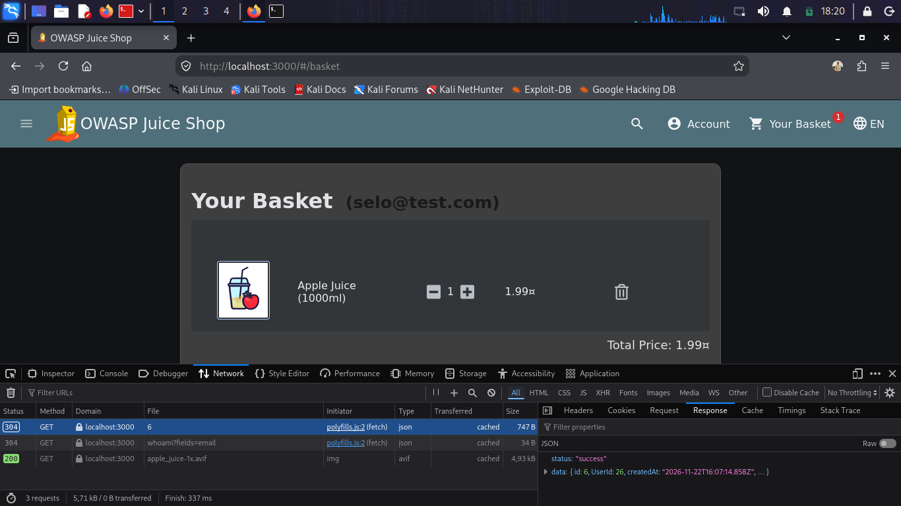
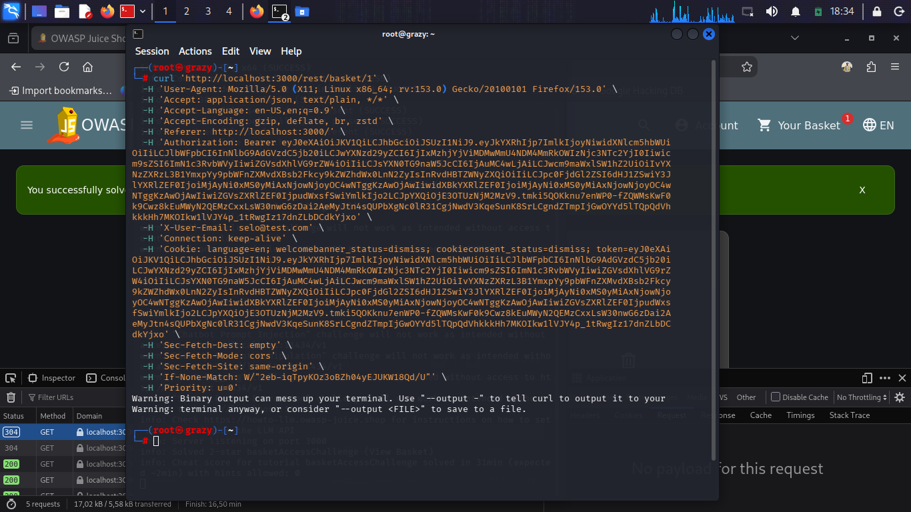
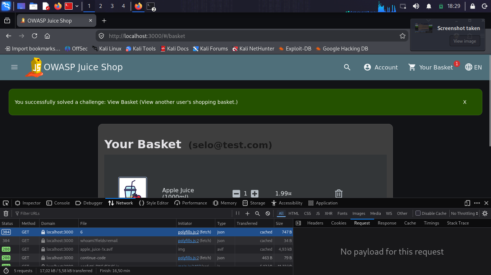

# Vulnerability Disclosure Report
**Candidate:** Selo David Sethibo
**Credential ID:** DT-2026-CIJOL
**Target Application:** OWASP Juice Shop (Local Instance)
**Date of Assessment:** November 22, 2026

---

## 1. Executive Summary
During a security assessment of the OWASP Juice Shop web application, I identified a high-impact Insecure Direct Object Reference (IDOR) vulnerability, which also falls under the OWASP API Top 10 category of Broken Object Level Authorization (BOLA). 

The application exposes an API endpoint (`/rest/basket/{id}`) that retrieves the contents of a user's shopping basket based on a numeric ID. While the endpoint requires the user to be authenticated, it fails to verify if the authenticated user actually owns the requested basket. By intercepting the request and changing the basket ID to a different number, an attacker can view the shopping cart contents and User IDs of other customers. This breaks tenant isolation and exposes sensitive customer data.

## 2. Vulnerability Classification & Severity
*   **Vulnerability Type:** Insecure Direct Object Reference (IDOR) / Horizontal Privilege Escalation
*   **OWASP API Top 10:** API1:2023 Broken Object Level Authorization
*   **CWE:** CWE-639 (Authorization Bypass Through User-Controlled Key)
*   **CVSS 3.1 Score:** 6.5 (Medium)
*   **CVSS 3.1 Vector String:** `CVSS:3.1/AV:N/AC:L/PR:L/UI:N/S:U/C:H/I:N/A:N`

**CVSS Justification:**
*   **Attack Vector (Network):** The vulnerability can be exploited remotely over the internet.
*   **Privileges Required (Low):** The attacker must have a standard, valid user account to obtain a session token.
*   **Confidentiality (High):** The attacker can read arbitrary users' shopping cart data.

## 3. Technical Analysis & Impact
The application relies solely on client-side routing and API parameter values to determine which basket to display. When a user clicks on "Your Basket," the frontend issues a `GET` request to the backend with the user's assigned basket ID. 

Because the backend lacks an authorization middleware check (e.g., verifying that the `UserId` in the JWT token matches the `UserId` associated with the requested Basket ID), the server blindly trusts the ID provided in the URL. An attacker can enumerate IDs (e.g., 1, 2, 3, 4) to map out the entire database of customer baskets. In a real-world scenario, this could leak PII, purchasing habits, and internal identifiers.

## 4. Steps to Reproduce (Proof of Concept)
To demonstrate this vulnerability, I performed the following steps using a standard browser and a terminal:

**Step 1: Establish a baseline**
I logged into the application as `selo@test.com`, added an item to my basket, and opened the Browser Developer Tools (F12) Network tab. Clicking the basket icon revealed my authorized API request to `/rest/basket/6`. 

**Step 2: Intercept and Modify the Request**
I copied the authorized request as a `cURL` command and pasted it into the terminal. Without altering any authentication headers or cookies, I changed the requested basket ID at the end of the URL from `6` to `1`. The terminal output below shows the modified request returning unauthorized data.

**Step 3: Verify the Exploit**
By pressing Enter, the server processed the request and returned an `HTTP 200 OK` response containing the JSON data for Basket 1. The Juice Shop application itself logged this action as a successfully solved challenge, confirming the authorization bypass.

## 5. Remediation Recommendations
To mitigate this vulnerability, the backend API must enforce strict object-level authorization. 

1.  **Server-Side Validation:** Do not trust the `basketId` provided by the client. Extract the `UserId` from the authenticated session (e.g., the JWT or session cookie) and query the database for *that specific user's* basket.
2.  **Authorization Middleware:** Implement a middleware function that checks if the requested resource belongs to the requesting user before returning the data. 
3.  **Fail Securely:** If a user attempts to access a basket that does not belong to them, the server should return an `HTTP 403 Forbidden` or `HTTP 404 Not Found` to prevent data leakage and ID enumeration.
